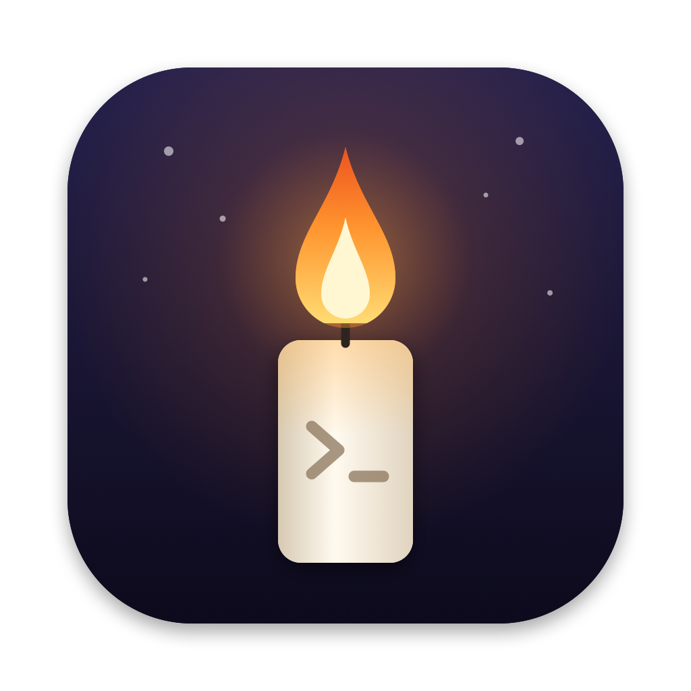
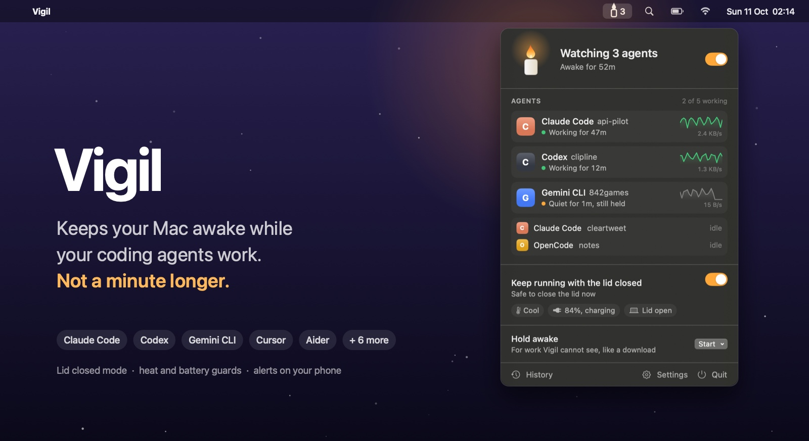

<p align="center">
  
</p>

<h1 align="center">Vigil</h1>

<p align="center">
  Keeps your Mac awake while your coding agents work. Not a minute longer.
  <br>
  Free and open source. For macOS 14 and later.
  <br>
  <a href="../../releases/latest">Download&nbsp;&rsaquo;</a>
  &nbsp;&nbsp;
  <a href="#build-from-source">Build from source&nbsp;&rsaquo;</a>
</p>

<p align="center">
  
</p>

<br>

## Why Vigil

Agents such as Claude Code and Codex now work for an hour or more on their own. If the Mac sleeps halfway through, the work stops with it. The usual fixes are `caffeinate`, an app that keeps the Mac awake on a timer, or changing the sleep settings and forgetting to change them back. All of them make you guess how long the work will take. Guess short and the agent dies mid task. Guess long and a closed laptop keeps running for nothing.

Vigil watches the agents instead. It keeps the Mac awake while one of them is working, lets it sleep a few minutes after the last one stops, and can keep going with the lid closed.

## What it does

**Knows when an agent is working.** Vigil finds Claude Code, Codex, Gemini CLI, Copilot CLI, Cursor Agent, OpenCode, Amp, Aider, Goose, Qwen Code and Droid in the process table, whether they run in a terminal, inside an editor or under a node wrapper. An agent counts as working while it streams from its model, while a tool it just started is running, or while its tools are busy on the CPU. An agent idle at its prompt does not count, even when its host keeps it ticking over in the background.

**Holds the Mac awake, then lets go.** While any agent works, Vigil holds the same power assertion as `caffeinate -i`. When the last one goes quiet it waits a grace period, three minutes by default, so a slow reply or a pause between steps does not end the session. Then the Mac sleeps as usual.

**Keeps working with the lid closed.** macOS sleeps when the lid closes, whatever any app asks for. With lid mode on, Vigil turns that off only while an agent works and turns it back on the moment the session ends. If the lid is closed by then, it puts the Mac to sleep straight away.

**Stops itself when it should.** Lid mode is paused when the Mac runs hot or the battery falls below a limit you choose, 25% by default. At a critical temperature Vigil lets go of everything.

**Tells you when an agent stops.** After a real stretch of work, Vigil posts a notification when an agent stops, which means it has finished or is waiting for you. With an [ntfy](https://ntfy.sh) topic set, the same alerts reach your phone, but only while you are away from the Mac.

**Holds for work it cannot see.** A download or a render started by hand can be held for 30 minutes, an hour, two, four, or until you stop it.

## Lid mode and your password

Turning off sleep for a closed lid needs root, so lid mode asks for your password once. It installs a single sudoers rule at `/etc/sudoers.d/vigil`:

```
you ALL=(root) NOPASSWD: /usr/bin/pmset -a disablesleep 1, /usr/bin/pmset -a disablesleep 0
```

That lets your account run exactly those two commands without a password, and nothing else. The rule is checked with `visudo` before it is moved into place, so a bad file can never break `sudo`.

Vigil also installs a small launch agent, `com.thefolahan.vigil.guard`, that runs every 30 seconds and at login. If Vigil turned sleep off and is no longer running, after a crash for example, the guard turns sleep back on.

**Remove lid mode** in Settings deletes the rule and turns sleep back on. Keep a closed Mac on a hard surface with air around it, never in a bag.

## Command line

The app includes `vigil`, a command line tool. Link it onto your path:

```sh
ln -s /Applications/Vigil.app/Contents/Helpers/vigil /usr/local/bin/vigil
```

```
vigil status [--json]          Show every running agent and whether it is working.
vigil watch                    Print a line whenever an agent starts or stops working.
vigil wait [--grace SECONDS]   Block until no agent has worked for SECONDS (default 60).
vigil run COMMAND [ARGS...]    Keep the Mac awake until COMMAND exits.
vigil agents                   List the agents Vigil recognises.
```

`vigil wait && say "done"` speaks when your agents finish. `vigil run npm test` keeps the Mac awake for exactly one test run.

## How it decides

Every five seconds Vigil reads the process table through `libproc`, finds the agents by executable, script path or install path, and samples three signals for each one:

| Signal | Source | Why |
| --- | --- | --- |
| Traffic to the model | `nettop` byte counters | A streaming reply moves hundreds of bytes a second or more. An idle session only sends keep alive pings, about 15. Traffic must be seen in two of the last three samples, so a background sync does not count. |
| A fresh tool | Child processes and their start times | A command started just after the model's last reply is the agent running a tool. It counts for up to 10 minutes, so a dev server left in the background cannot hold the Mac forever. |
| Busy tools | CPU time of every process below the agent | A build or a test run started by the agent counts for as long as it keeps the CPU busy. |

CPU use of the agent itself barely counts. Some editors keep an idle agent at around one percent of a core, so only heavy local work, above 15%, counts on its own.

## Install

1. Download `Vigil.dmg` from the [latest release](../../releases/latest).
2. Open it and drag Vigil to Applications.
3. The release is not notarised, so the first time, open it from Finder with right click, **Open**, or allow it in **System Settings, Privacy & Security**.

Vigil lives in the menu bar. The candle is lit while it keeps the Mac awake and solid while lid mode is holding.

## Build from source

Requires Xcode 15.3 or later.

```sh
git clone https://github.com/thefolahan/vigil.git
cd vigil
swift test
scripts/build-app.sh --dmg
open build/Vigil.app
```

## Privacy

Vigil reads process names, arguments, working folders and byte counters on your Mac and keeps none of them. Nothing leaves the Mac unless you set an ntfy topic, and then only the alert text.

## License

MIT
